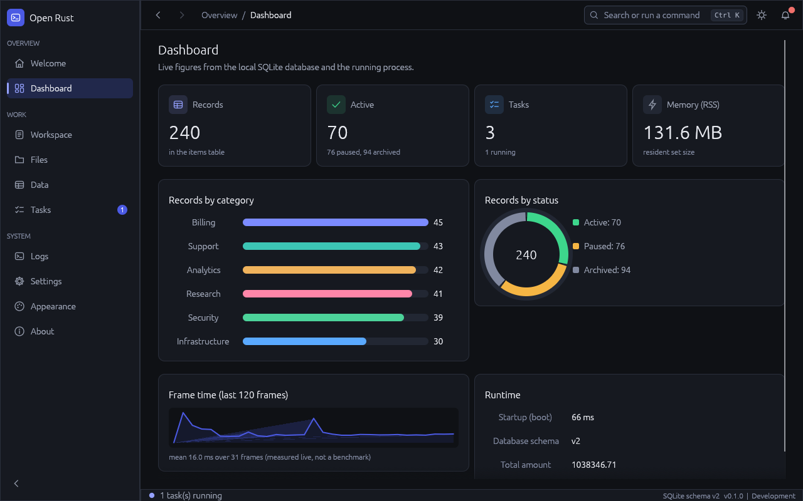
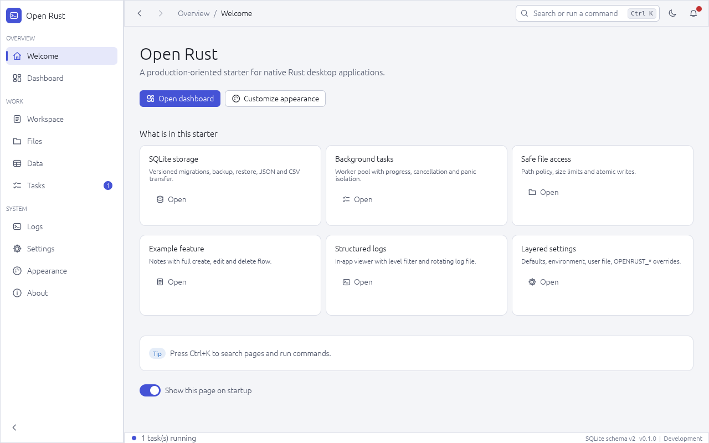
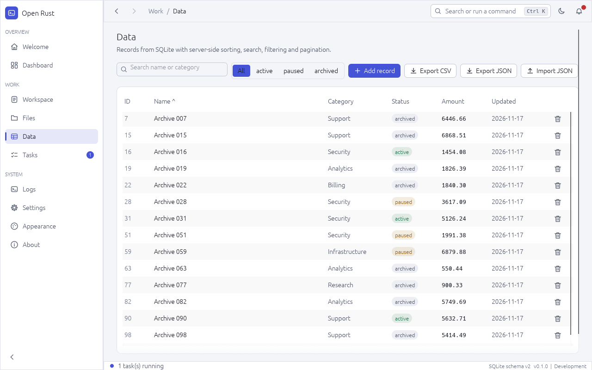
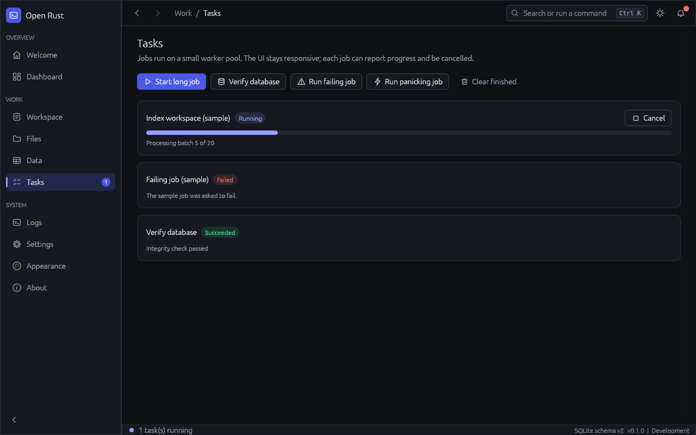
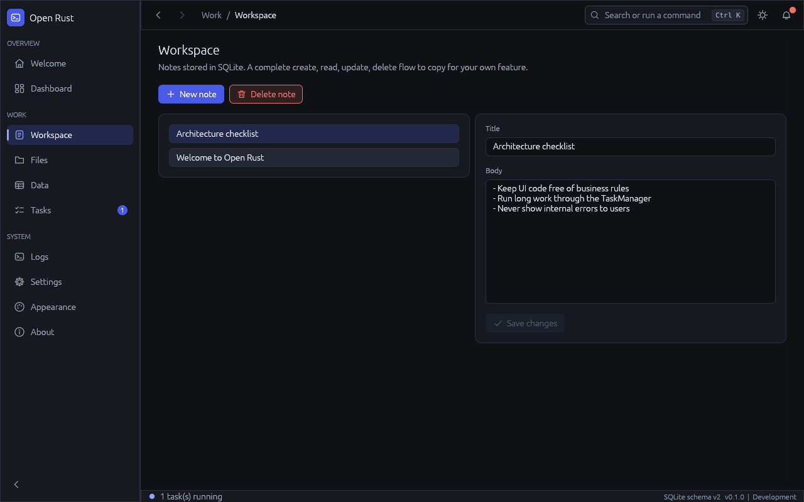
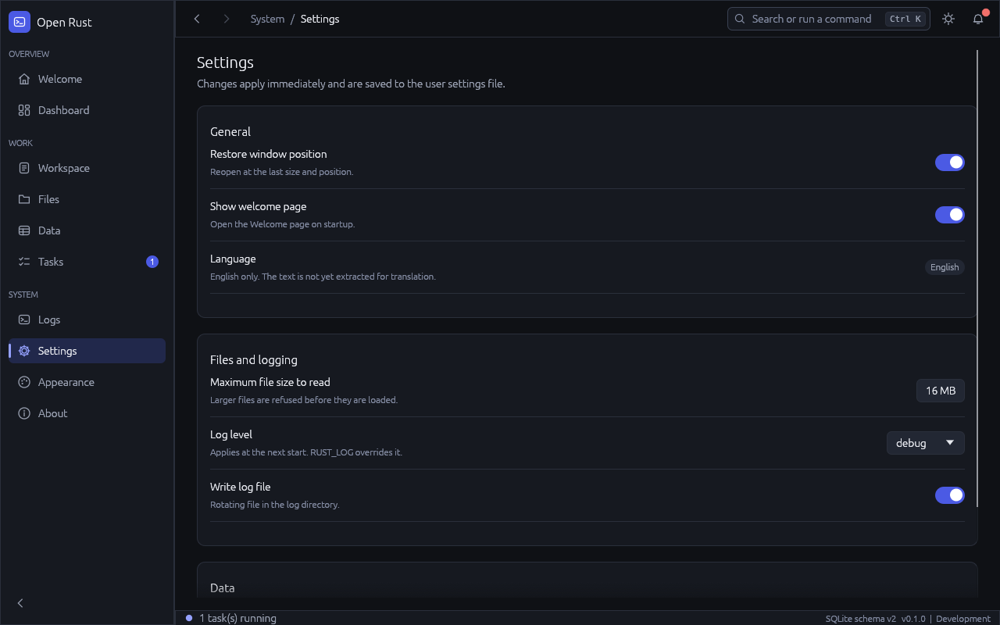
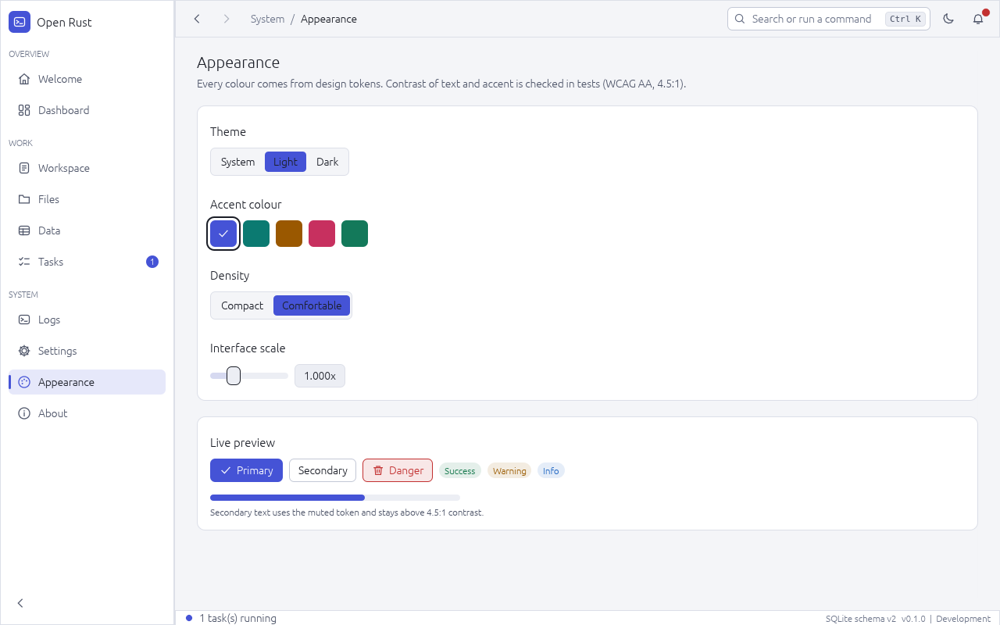

<div align="center">


# Open Rust

**A production-oriented starterpack for native Rust desktop applications.**

egui/eframe UI on a headless, tested Rust core: SQLite storage, background tasks, layered
settings, a design system, a security foundation, and packaging scripts.

[](https://github.com/robotjaol/open-rust/actions/workflows/ci.yml)


</div>



## Why this exists

Most Rust GUI templates stop at "a window with a button". Real desktop apps also need
storage, settings that survive upgrades, background work that can be cancelled, safe file
access, crash recovery and an installer. This repository provides those pieces, wired together,
tested, and documented, so you can delete what you do not need instead of building it all.

## Features

- **Eleven working screens**: Welcome, Dashboard, Workspace (notes CRUD), Files, Data table, Tasks, Logs, Settings, Appearance, About, Recovery. Every button does something.
- **Design system**: light, dark and system themes; five accents; contrast checked by tests (WCAG AA 4.5:1); vector icons; charts; command palette (`Ctrl+K`); toasts; confirm dialogs.
- **Storage**: SQLite with versioned migrations, backup and restore (validated before swap), JSON/CSV export, bounded JSON import.
- **Background tasks**: worker pool with progress, cancellation, panic isolation and graceful shutdown.
- **Settings**: layered (defaults, environment, file, `OPENRUST_*`), schema migration, atomic save, corrupt file preserved.
- **Reliability**: typed errors with safe user messages, structured logs with in-app viewer and rotating file, crash reports and a Recovery page.
- **Security foundation**: path policy, size limits, atomic writes, CSV injection guard, `Redacted<T>`, `SecretStore`; `unsafe` forbidden; threat model in [docs/security.md](docs/security.md).
- **Extensible**: add a page by implementing one trait ([guide](docs/extending-the-application.md)).
- **Tested and benchmarked**: unit, property and integration tests; Criterion benchmarks.
- **Shippable**: Linux `.tar.gz` and `.deb` script; cargo-packager config for Windows and macOS; GitHub Actions CI and release.

## Screenshots

Generated by the application itself (`open-rust --screenshot-dir`), 1280x800, software
rendering under Xvfb. All 22 images (11 pages x 2 themes) are in [docs/screenshots](docs/screenshots).

| Welcome (light) | Data table (light) |
|---|---|
|  |  |

| Tasks (dark) | Workspace (dark) |
|---|---|
|  |  |

| Settings (dark) | Appearance (light) |
|---|---|
|  |  |

## Architecture

```
apps/desktop  --->  ui-components (egui widgets, tokens)
     |
     v
app-core  (AppContext, TaskManager, EventBus, AppState, notifications)
     |--> app-config   |--> app-storage   |--> app-platform
     |--> app-security |--> app-logging   `--> app-errors
```

Crates below `ui-components` do not know about egui, so the core is tested without a window.
Details: [docs/architecture.md](docs/architecture.md), decisions in [docs/adr](docs/adr).

## Technology stack

| Concern | Choice |
|---|---|
| Language | Rust 2024 edition, rustc 1.95+ |
| GUI | egui / eframe 0.37 (glow renderer) |
| Storage | SQLite via rusqlite 0.43 (bundled) |
| Config | serde + TOML |
| Logging | tracing + tracing-subscriber |
| Errors | thiserror |
| Dialogs | rfd (XDG portal on Linux) |
| Tests | built-in, proptest, tempfile, criterion |
| Packaging | dpkg-deb script, cargo-packager |

Why egui, and what it costs: [ADR-0001](docs/adr/0001-gui-framework.md),
[research](research/desktop-framework-comparison.md), [decision matrix](docs/technology-decision-matrix.md).

## Compatibility matrix

| Platform | Builds | Runs (human-checked) | Automated tests | Installer |
|---|---|---|---|---|
| Linux x86_64, X11 | Yes | Yes (headless Xvfb, software GL) | Yes | `.tar.gz`, `.deb` built locally |
| Linux Wayland | Not validated | Not validated | n/a | n/a |
| Windows 10/11 | CI configured | **Not validated** | CI configured | NSIS configured, **not built** |
| macOS | CI configured | **Not validated** | CI configured | dmg configured, **not built** |

"CI configured" means the workflow exists; check the badge above for its current state.
Code signing and notarization are documented but not performed.

## Installation

From source (all platforms):

```bash
git clone https://github.com/robotjaol/open-rust && cd open-rust
cargo run -p open-rust --release
```

Linux packages (after a release exists): download the `.deb` or `.tar.gz` from the Releases page,
then `sudo apt install ./open-rust_<version>_amd64.deb`.

## Development setup

```bash
rustup toolchain install stable
cargo run -p open-rust                      # debug build with demo data
cargo run -p open-rust -- --home ./.demo    # portable data directory
```

Linux needs a C compiler; windowing and GL libraries are loaded at run time. See
[getting started](docs/getting-started.md) and [troubleshooting](docs/troubleshooting.md).

## Build

```bash
cargo build --release -p open-rust
```

Release profile: thin LTO, one codegen unit, stripped symbols, `panic = "unwind"` (needed to isolate task panics).

## Testing

```bash
cargo fmt --all -- --check
cargo clippy --workspace --all-targets -- -D warnings
cargo test --workspace
cargo bench -p app-storage -p app-core
```

Results of the last full run and an honest status table are in the [QA report](docs/qa-report.md).

## Packaging

```bash
./scripts/package-linux.sh        # tar.gz and deb into dist/
cargo packager --release          # Windows/macOS installers (unvalidated)
```

See [docs/packaging.md](docs/packaging.md).

## Add your own feature

```rust
pub struct Contacts;

impl FeatureModule for Contacts {
    fn page(&self) -> Page { Page::Contacts }
    fn icon(&self) -> Icon { Icon::Notebook }
    fn subtitle(&self) -> &'static str { "People you work with" }
    fn ui(&mut self, ui: &mut egui::Ui, cx: &mut Cx<'_>) {
        widgets::page_header(ui, &cx.pal, "Contacts", "A minimal example page.");
    }
}
```

Register it in `registry()`; navigation, command palette and breadcrumb update themselves.
Full walkthrough: [docs/extending-the-application.md](docs/extending-the-application.md).

## Known limitations

- Windows and macOS behaviour is unvalidated.
- egui draws its own widgets; they are not native controls. Screen-reader support depends on AccessKit and was not tested.
- No OS keyring integration, no auto-update, no installer signing.
- Language is English only (strings are not yet externalised).
- Reduced-motion preference is not implemented.

## Documentation map

[docs/](docs) (19 guides) | [research/](research) (sourced analysis, see the [source register](research/source-register.md)) | [ADRs](docs/adr) | [Changelog](CHANGELOG.md)

## Contributing

Read [CONTRIBUTING.md](CONTRIBUTING.md) and the [Code of Conduct](CODE_OF_CONDUCT.md).
Report vulnerabilities privately as described in [SECURITY.md](SECURITY.md).

## License

Licensed under either of [Apache License 2.0](LICENSE-APACHE) or [MIT license](LICENSE-MIT) at your option.
Copyright 2026 robotjaol.
